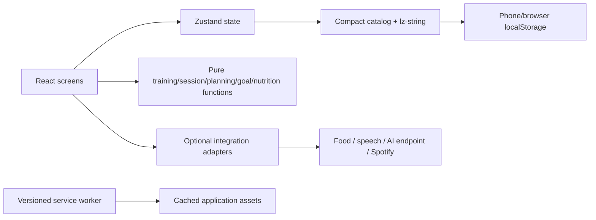

# Setwise architecture

Setwise is a local-first React/TypeScript PWA. The web app runs without an account or server for workouts, planning, analytics and manual nutrition. A Capacitor iOS source project is generated at `ios/App/App.xcodeproj`, with Swift Package Manager and a copied web bundle. No Xcode build, signing, simulator/device run or native health integration was tested in this Windows environment.

The welcome screen precedes optional setup. On mobile, navigation reserves a separate row while the content pane scrolls, keeping the final content clear of the footer. Equipment adaptation uses ranked alternatives with stated rationale and an explicit skip choice.

## Modules

| Area                    | Implementation                                                                                                              | Responsibility                                                                                                                                  |
| ----------------------- | --------------------------------------------------------------------------------------------------------------------------- | ----------------------------------------------------------------------------------------------------------------------------------------------- |
| Application shell       | `src/App.tsx`, `src/main.tsx`                                                                                               | Launch, navigation, equipment switcher, day-first Home/Train, workout adaptation, summaries, appearance attributes, errors and PWA registration |
| Shared UI/setup         | `src/components/ui.tsx`, `src/components/inputs.tsx`, `src/components/Onboarding.tsx`, `src/components/HeightInput.tsx`     | Buttons, labels/dialogs, Radix choices, editable numeric fields, visible optional setup, cm/feet-and-inches entry and feedback                  |
| Daily workouts          | `src/components/DailyWorkouts.tsx`                                                                                          | Shared actual-date calendar list, status actions and empty/rest states for Home and Train                                                       |
| Visual system           | `src/styles.css`, `src/training.css`, `src/optional.css`, `src/controls.css`, `src/workout-focus.css`, `src/refinement.css` | Semantic dark/appearance tokens, responsive layout, controls, focused workout mode, charts and optional module styles                           |
| Domain contracts        | `src/domain/types.ts`, `src/domain/helpers.ts`                                                                              | Typed records, IDs, local calendar dates and prescriptions                                                                                      |
| Session engine          | `src/domain/session.ts`                                                                                                     | Immutable exercise/prescription snapshots, previous-performance defaults, validation and idempotent completion                                  |
| Training engine         | `src/domain/engine.ts`                                                                                                      | Units, e1rm, volume, muscle contributions, equipment matching, substitutions, suggestions, goals, records and streaks                           |
| Program application     | `src/domain/planning.ts`, `src/components/ProgramApply.tsx`, `src/components/ProgramPhases.tsx`                             | Validated calendar previews, keep/replace application, optional weekly phases and separate planned target versions                              |
| Goal time planning      | `src/domain/goalTimeline.ts`                                                                                                | Editable constant-rate/duration arithmetic, explicit/manual deadlines, weight-unit conversion and recorded first target crossing                |
| Persistence             | `src/state/store.ts`, `src/state/persistence.ts`                                                                            | Zustand state, compact compressed localStorage, queued writes, conflict checks, validation, recovery and legacy read-only migration             |
| Exercise content        | `src/data/exercises.ts`, `src/data/defaults.ts`                                                                             | Bundled licensed instructions, editable starter templates/programs, example inventories and empty personal history                              |
| Library and planning    | `src/screens/Library.tsx`, `src/screens/Plan.tsx`, `src/screens/TrainingRules.tsx`                                          | Search/detail/custom exercises, calendar, templates, training blocks and rule editing                                                           |
| Recording and analytics | `src/screens/Workout.tsx`, `src/screens/Progress.tsx`                                                                       | Set logging, timers, history correction, trends, goals and suggestion decisions                                                                 |
| Nutrition               | `src/screens/Nutrition.tsx`, `src/nutrition/helpers.ts`                                                                     | Food diary, servings, recipe calculations, saved meals, targets, water and CSV export                                                           |
| Optional adapters       | `src/integrations/*`                                                                                                        | Food lookup/scanning, speech, AI endpoint, Spotify, reminders/calendar and native capability boundaries                                         |
| Settings                | `src/screens/Settings.tsx`                                                                                                  | Profile/inventory editing, local accent/spacing preferences, toggles, permissions, integrations, backups and privacy controls                   |
| Packaging/tests         | `vite.config.ts`, `capacitor.config.ts`, `ios/App/`, `vitest.config.ts`, `playwright.config.ts`, `tests/`                   | Production assets, PWA, generated iOS source project, domain/persistence tests and browser journeys                                             |

Additional domain modules: `src/domain/search.ts` ranks typo-tolerant exercise matches; `src/domain/templates.ts` handles sorting and snapshot-preserving deletion; `src/domain/workoutIcons.ts` describes the 22-glyph picker; `src/domain/timer.ts` computes epoch-based timed-set state. The read-only `src/data/foods.ts` catalog enters local records only when a food is chosen. `src/evergreen.css`, `src/planning-ui.css` and `src/timed-exercise.css` provide the current visual rules.

Plain CSS implements the design tokens rather than introducing Tailwind. Native inputs/dialogs and custom Radix Select menus provide the component foundation. Numeric controls keep their editable text separate from the displayed persisted number. Screen navigation uses lightweight application state rather than React Router: all destinations share the root URL. Charts are accessible SVG with inspectable data tables rather than Recharts. Training calculations remain outside components.

## Persistence and recovery

The current app uses phone/browser `localStorage` key `forma.data.v1`. It creates no new database and uses no Dexie runtime or external storage service. The full typed `AppData` exists in memory; persistence stores non-catalog data, ordered exercise IDs and only edited/custom exercise overrides, compressed with `lz-string` UTF-16. A header identifies the encoding, bundled catalog, revision and writer. Normal JSON backups contain complete readable `AppData`, including the full catalog and historical snapshots.

`updateData` clones the current aggregate, applies the mutation, updates `updatedAt` and immediately exposes the draft to React. A serialized promise queue encodes and replaces the single local-storage key. The UI reports saving/errors separately from optimistic state. Before saving, the store compares the exact saved record against the last one this tab loaded or wrote. Changed records block stale writes; this tab's unsaved branch remains exportable. Web Locks coordinate cooperating tabs when supported. The fallback performs synchronous read/check/write but cannot guarantee an atomic operation across browser processes. There is no automatic merge or remote synchronization.

Initialization decodes and validates stored records before use. Invalid/unsupported records block edits and remain recoverable; an undecodable record exports its exact raw storage string in a recovery wrapper. It is not silently replaced by seed data. Full JSON import validates first and replaces saved data only after a successful `setItem`. Explicit restores are queued and prevent intervening edits. Failed saves preserve the previous saved string and current in-memory draft, with visible error/recovery controls. Wait for saving to finish before closing and keep backups.

Local storage is quota-limited and synchronous. Compression avoids repeating the full built-in library, but histories, snapshots and custom media still consume space and encoding time. An accepted media file can still exceed available storage when saved; upload limits are not quota guarantees. There is no silent deletion to make room. Large collections need measured optimization and a deliberate, user-approved storage strategy.

If the new local-storage key is absent, initialization checks for the old `forma-training` IndexedDB record, reads it with a native read-only transaction, validates it and saves the migrated state locally. A missing legacy database is not created: enumeration skips it, or a creation upgrade is aborted. Legacy data is retained until explicit **Delete all local app data**; migration failures leave it recoverable. Current local-storage records always take precedence.

Encoding, backup schema and catalog identifiers are versioned independently. The catalog identifier derives from bundled content; changing that content requires a deliberate migration or full-backup import path. Unknown versions block editing instead of silently rehydrating different exercise definitions. No future-version migrations are claimed.

## Training integrity

An active session stores full exercise and prescription snapshots plus an optional focused session-exercise ID. Today's overview opens one exercise in a focused viewport with primary/secondary muscles, targets and set controls; returning to all exercises preserves values. Reload restores focus when its referenced exercise still exists; a stale focus is cleared without losing the session. Later template/catalog edits cannot rewrite snapshots. Previous working-set values are copied only as input defaults; a changed planned target takes precedence. Variations retain separate IDs. Equipment substitutes start at zero external load and preserve original IDs for traceability.

Session completion is keyed by stable ID and therefore does not duplicate a workout when retried. History corrections preserve original timestamps and do not discard an unrelated active workout. Warm-ups/skipped/unfinished sets are excluded from working analytics. Suggestions are pending records whose approval changes future template targets while leaving the active/completed session untouched.

## Calendar application and goal planning

Home selects a local calendar day and uses `DailyWorkouts` to render all matching schedule entries. Train defaults to the same actual-date list, with a separate Workout library for optional unscheduled starts. A day without entries shows an empty/rest state rather than an invented fallback workout. Summary metrics still come from recorded sessions.

`previewProgram` validates a block and produces dates, ordered workout rotation, week numbers and optional phase/lighter labels without mutating records. `ProgramApply` shows that preview and the impact on existing plans. `applyProgram` writes actual planned entries using the reviewed start/day pattern: keep mode retains plans; replace mode removes only unstarted, unlinked planned entries in range. Rest, skipped, completed and session-linked choices are protected, and matching occurrences are deduplicated. Onboarding uses the same application helper for an optional two-week Automatic or selected-preset starter calendar. Calendar creation never fabricates completed sessions.

Optional phase ranges supply repetition overrides and set/load multipliers. Application creates separate editable template variants with `planningSource` origin/signature metadata; matching variants can be reused. Lighter weeks combine the selected phase targets with explicit fixed reductions. Base templates and active/completed snapshots remain intact, and later program edits do not silently rewrite generated variants. These are deterministic planned targets, independent of progression suggestions or AI.

`goalTimeline` handles optional kg/lb bodyweight, load and e1rm estimates. The user can edit baseline, weekly rate, duration and anchor date; the last edited rate/duration sets the calculation mode. An estimated deadline follows those assumptions, while a manual deadline stays fixed. This arithmetic does not forecast adaptation or log a measurement. The first reached date comes only from the earliest recorded goal-history value crossing the current target. Supported goal-unit changes convert stored goal values/history/rates together.

`HeightInput` follows profile units while retaining `heightCm` as the canonical value. Appearance choices are optional profile fields, read into document data attributes and semantic CSS variables; they use the same local persistence and full JSON backup path as other preferences.

## Offline and updates

`vite-plugin-pwa` produces the manifest and a versioned Workbox service worker. The production shell, JavaScript—including secondary lazy chunks—CSS, icons and bundled exercise instructions are precached. Offline reload depends on a successful first online installation/cache preparation at the same origin. User records remain in local storage, independently of the app-asset cache.

Service-worker registration uses prompt-style update behavior and avoids showing the update message during an active session. Close all app tabs and reopen after finishing a workout to take a waiting version. No forced reload occurs mid-session. Exercise photos hosted by GitHub and live optional services are not precached; instruction text and core logging remain available without them.

## Integration boundaries

Nutrition, AI, voice and Spotify are off by default. Food search/barcode requests are initiated explicitly, cache complete returned food records locally, and have manual/offline fallbacks. Speech is push-to-talk with deterministic parsing and typed commands. Camera frames are processed locally. AI sends only user-requested questions and explicitly consented context to a configured endpoint; no provider key or backend is included. Spotify uses PKCE and transient tokens rather than a client secret.

Native capabilities explicitly report unavailable for HealthKit, Watch, Live Activities, Foundation Models, App Intents and native local notifications. The generated Capacitor wrapper does not provide those integrations. `npm run build` followed by `npm run ios:sync` copies updated web assets into the native project; compilation and signing still require Mac/Xcode. See [INTEGRATIONS.md](INTEGRATIONS.md), [PRIVACY.md](PRIVACY.md) and [DEPLOYMENT.md](DEPLOYMENT.md).
